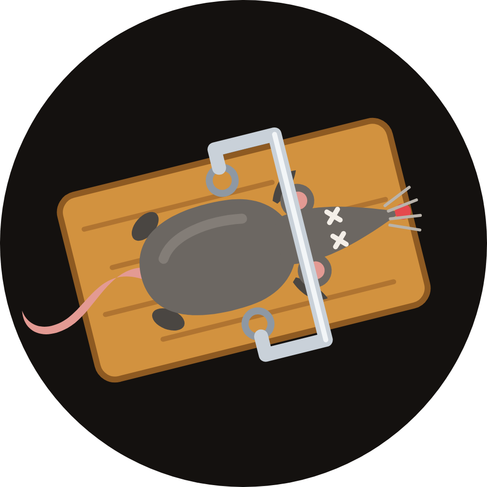

<p align="center"></p>

# 🐀 Ratcatcher

A scam bouncer for the Telegram groups your Hermes bot runs in.

Crypto groups get the same scams every day: fake airdrops, "validate your wallet" drainer links, "DM me for support", account managers who double your money, and new accounts wearing an admin's name. Ratcatcher reads every group message your Hermes bot can see, removes the scams before members or Hermes read them, and tells your admins what it did and why.

## What it does

- **Removes scams on sight**: wallet drainers, fake airdrops and giveaways, fake support and DM bait, doubling and "account manager" scams, phishing look-alike links (MetaMask, Phantom, Uniswap and more), punycode domains, link shorteners, links hidden behind normal text or buttons.
- **Bans admin and owner clones** the moment they join or speak: exact copies, "Name | Admin" style names, look-alike letters and copied usernames. Close-but-unsure names (a real member can share a first name) are muted and sent to you with a Ban button instead.
- **Mutes, then bans**: a mute on the first catch, a ban after repeat strikes (both adjustable).
- **Bans on sight** for near-certain scams: seed phrase asks, "send 1 get 2 back", fake recovery experts, anything on your blocklist.
- **Warns the group** with a short message that cleans itself up after a minute.
- **Reports to admins** in DM with Release and Ban buttons, so a false alarm is one tap to undo.
- **AI second look** only for borderline messages, using whatever model your Hermes already runs.
- **Protects Hermes too**: a removed scam never reaches the agent, so it cannot be used to prompt-inject your bot.
- **Ask Hermes about it**: "who did you ban today?", "is this message a scam?", "block claim-sign.xyz", "release catch 12".

## Install

```bash
hermes plugins install ratcatcher        # from the catalog, once listed
hermes plugins enable ratcatcher
```

Or from GitHub:

```bash
hermes plugins install Truthgeng/ratcatcher
hermes plugins enable ratcatcher
```

Then restart the Hermes gateway with Telegram connected.

## Set up the group

1. Add your Hermes bot to the group and make it **admin** with *Delete messages*, *Ban users* and *Invite users via link* (used to give released people a one-time rejoin link).
2. If the bot is not admin, turn privacy mode off in @BotFather (`/setprivacy` → Disable), or it only sees commands.
3. Start a DM with the bot, then set `report_chat_id` to your Telegram user id to get reports with buttons.
4. Add your project's real domains to `allowed_domains` so they are never flagged.
5. Busy group? Start in `mode: watch` for a day, check `/ratcatcher`, then switch to `enforce`.

Settings live under **Settings → Plugins → ratcatcher** in Hermes Desktop, or in `config.yaml`:

```yaml
plugins:
  entries:
    ratcatcher:
      settings:
        mode: enforce            # or watch
        report_chat_id: "123456789"
        allowed_domains: [sign.global, docs.sign.global]
        mute_minutes: 60
        ban_after: 3
```

| Setting | Default | What it does |
|---|---|---|
| `mode` | `enforce` | `watch` logs and reports only |
| `protected_chats` | all groups | Group ids to guard |
| `block_threshold` | `0.8` | Score at which a message is removed |
| `review_threshold` | `0.3` | Score at which the AI takes a second look |
| `ai_review` | `true` | Use the current model for borderline messages |
| `mute_minutes` | `60` | Mute length on a catch (0 = no mute) |
| `ban_after` | `3` | Strikes before a ban (0 = never) |
| `ban_on_sight` | `true` | Ban on the first message for near-certain scams |
| `ban_clones` | `true` | Ban accounts that clearly copy an admin or the owner |
| `warn_in_group` | `true` | Post a short warning after removing |
| `warning_ttl_seconds` | `60` | Delete the warning after this long |
| `report_chat_id` | none | Where admin reports go |
| `allowed_domains` | none | Your trusted domains |
| `new_member_hours` | `24` | How long someone counts as a new member |

## Tools Hermes gets

| Tool | Use |
|---|---|
| `ratcatcher_check` | Score any pasted message or link (read-only) |
| `ratcatcher_report` | Totals and the latest catches (read-only) |
| `ratcatcher_blocklist` | List, add or remove blocked domains and phrases |
| `ratcatcher_release` | Undo a false alarm: unmute, unban, clear strikes |

Slash command: `/ratcatcher` for status, `/ratcatcher check <text>` to test a message.

## How it decides

Every message gets a score from 0 to 1 from fast local rules: scam phrases (with look-alike letters and leetspeak folded back), every link's real domain, hidden links, support-bot handles, wallet addresses next to "send", and names copied from your admins. New members and first messages with links score a little higher. Safety advice like "never share your seed phrase" scores lower. Admins are never touched.

At or above the remove score, Ratcatcher acts. Between the second-look score and the remove score, your current model reviews the message once, with the message treated as untrusted data. Below that, nothing happens.

## Disclosure

- **Telegram actions**: deletes group messages, restricts (mutes) and bans members, posts warnings, and sends reports, all through your own Hermes bot. It only acts in groups, never in DMs.
- **Network**: no calls to any third-party service. Link checks are local; links are never opened.
- **LLM calls**: only for borderline messages and only when `ai_review` is on, through Hermes's `ctx.llm` with your current provider. The message text is sent to that model.
- **Data stored**: catches (sender name and id, up to 600 characters of the removed message, reasons, action), strike counts, join times and message counts per member, and your blocklist, in the plugin's own SQLite file under `HERMES_HOME/plugin-data/ratcatcher/`. Nothing leaves your machine.
- **Hermes surfaces**: `register_telegram_handler` (in-process only), `register_tool`, `register_command`, `register_skill`, `ctx.get_config`, `ctx.llm`, `plugins.plugin_storage`. No core overrides, no shell commands, no background processes beyond the gateway's own Telegram loop, no stored credentials, no telemetry.

## Develop

```bash
python -m pytest tests                       # needs python-telegram-bot
hermes plugins validate . --install-deps
hermes plugins doctor . --ci
```

MIT licensed.
